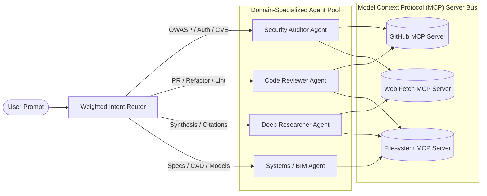
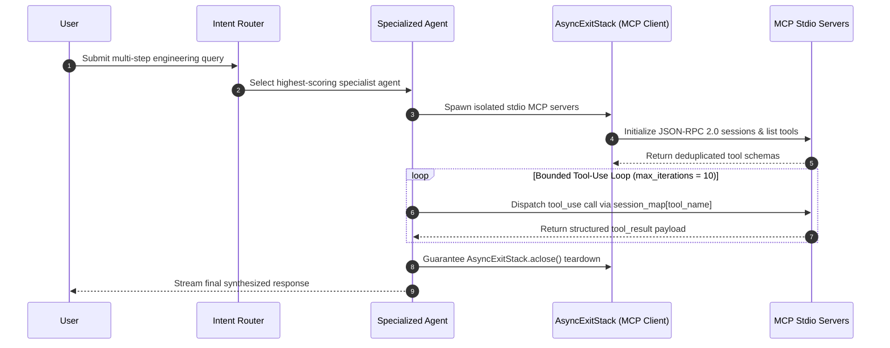

# Multi-Agent LLM Orchestration Platform with Model Context Protocol (MCP)

[](#)
[](#)
[](#)
[](#)

Production **Multi-Agent LLM Orchestration Platform** implementing **Model Context Protocol (MCP)** stdio server lifecycle management, weighted intent routing, cross-server tool schema deduplication, and bounded agentic tool-execution loops.

---

## Multi-Agent MCP Architecture



---

## MCP Tool-Call Execution Workflow



---

## Key Bug Fixes & Production Hardening

1. **Zero-Leak MCP Subprocess Teardown (`connect_mcp_servers`):** Wrapped multi-server `stdio_client` initialization inside `try / except BaseException: await stack.aclose(); raise` so a failing second MCP server never leaves zombie `npx` child processes running.
2. **Cross-Server Tool Schema Deduplication:** Prevented Anthropic API `400 Bad Request (duplicate tool name)` errors when two MCP servers expose identically named tools.
3. **Bounded Agentic Tool Loop (`run_agent_async`):** Added `max_iterations = 10` guard to the `while response.stop_reason == "tool_use":` loop to prevent infinite tool-calling cycles.
4. **Weighted Intent Classification (`classify_query`):** Upgraded greedy first-match keyword checks to weighted multi-keyword scoring so queries mentioning both `"test"` and `"SQL injection vulnerability"` route accurately to `security_auditor`.

---

## Quickstart

```bash
git clone https://github.com/shubh9119/multi-agent-mcp-orchestrator.git
cd multi-agent-mcp-orchestrator
pip install -r requirements.txt
streamlit run app.py
```

### Run Unit Tests
```bash
pytest -v
```
